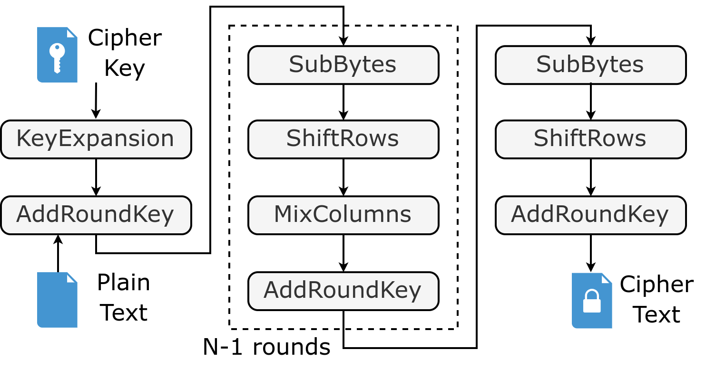

#Advanced Encryption Standard (AES/FIPS-197)

## Overview & Mathematical Foundations

The Advanced Encryption Standard (AES) is a variant of Rijndael block cypher, announced by NIST in 2001 and adopted by the US government. The **US FIPS 192** standard defines a symmetric-key algorithm, meaning the same key is used for both encrypting and decrypting the data.

The algorithm works with a fixed block size of **128 bits** and a key size of 128, 192 or 256 bits. The cypher key length defines the number of transformation rounds that convert the **plaintext** into the final **ciphertext**. Each round is a repetition of well-defined and sequential processing steps and may be exploited in hardware architectures for different PPA targets.

| **Key Length** | **Rounds** |
|:--------:|:---:|
| 128 bits | 10  |
| 192 bits | 12  |
| 256 bits | 14  |

## Algorithm Description

Each standard round of AES consists of four distinct byte-oriented transformations:

### SubBytes (Non-linear Substitution)

A byte-by-byte substitution using a pre-calculated S-box based on the multiplicative inverse in $\text{GF}(2^8)$ followed by an affine transformation. This provides cryptographic confusion.

### ShiftRows (Linear Diffusion)

Cyclic shifting of the rows of the State matrix to the left:

    - Row 0: Unshifted (offset 0);
    - Row 1: Shifted by 1 byte.
    - Row 2: Shifted by 2 bytes.
    - Row 3: Shifted by 3 bytes.

### MixColumns (Column-wise Mixing):
Each column of the State is multiplied modulo $x^4 + 1$ with a fixed polynomial $c(x) = {03}x^3 + {01}x^2 + {01}x + {02}$. This mixes the bytes within each column, providing diffusion. (Note: Omitted in the final round).

### AddRoundKey (Key Mixing):
The round key is combined with the State via a simple bitwise XOR operation.

## Key Expansion Schedule

The Key Expansion algorithm takes the initial cipher key and expands it into a schedule of round keys. For a 128-bit key, it generates 44 32-bit words ($W[0]$ through $W[43]$):

    - Words in positions multiple of 4 undergo RotWord (cyclic byte shift), SubWord (S-box substitution), and an XOR with a round constant ($\text{Rcon}[i]$) before being XORed with the word four positions prior.
    - Intermediate words are derived via simple XOR chaining: $W[i] = W[i-1] \oplus W[i-4]$.
