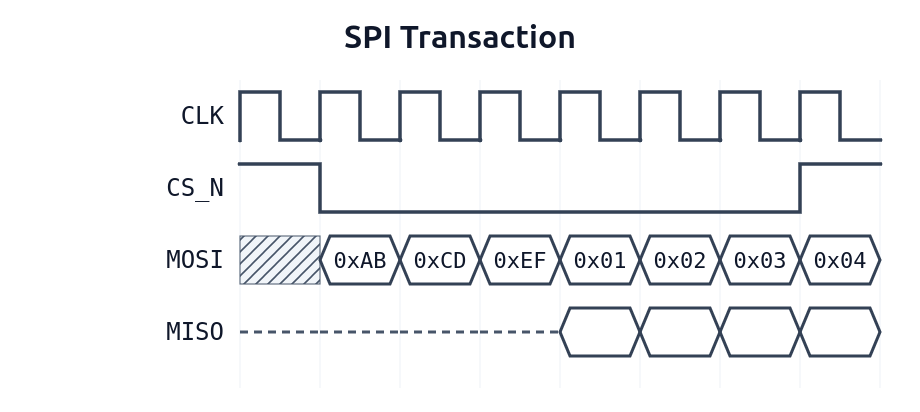

# Serial Peripheral Interface (SPI) Protocol

The Serial Peripheral Interface (SPI) is a synchronous, full-duplex communication protocol developed by Motorola. It facilitates master-slave communication using a star or daisy-chain topology for short-distance inter-chip data transfers.

The standard SPI bus utilizes four core signals:

| **Signal** | **Meaning** | **Description** |
|:----------:| ----------- | --------------- |
|`SCLK` | Serial Clock | Driven by the master to synchronize data transmission.
|`MOSI` | Master Out Slave In | Data line carrying signals from the master to the peripheral slave.
|`MISO` | Master In Slave Out | Data line carrying signals from the peripheral slave back to the master.
|`CS`   | Chip Select | Active-low signal asserted by the master to individually select a target slave device.

Unlike UART or I2C, SPI has no rigid framing standard, meaning master and slave must agree on the clock configuration. This is defined by two parameters: `CPOL` and `CPHA`, indicating clock polarity and phase, respectivelly.

> **Note:** In this project, it will be assumed positive edge polarity and phase equal to zero.

